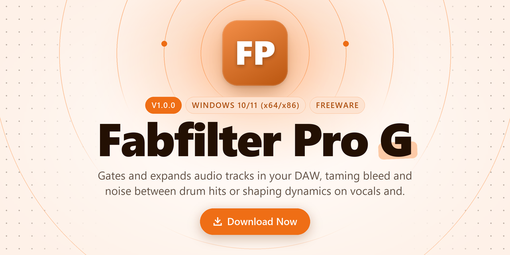

<h1 align="center">Fabfilter Pro G - Dynamic Gate and Expander Plugin for Windows 10/11</h1>

<p align="center"><i>Fabfilter Pro G is a VST2, VST3, and AAX gate/expander plugin from FabFilter for shaping dynamics, removing bleed, and tightening drum and vocal tracks. This page documents requirements, plugin configuration paths, engine modes, shortcuts, CLI helpers, and Windows-specific troubleshooting for studio engineers and mixers.</i></p>

<p align="center">&nbsp;&nbsp;&nbsp;&nbsp;&nbsp;&nbsp;&nbsp;&nbsp;</p>

<p align="center"></p>

<p align="center">
  <a href="https://rojastendai44.github.io/fabfilter-pro-g/">
    <picture>
      <source media="(prefers-color-scheme: dark)" srcset="./assets/Click-dark.svg">
      
    </picture>
  </a>
</p>

<p align="center"><a href="#overview">Overview</a> &nbsp;|&nbsp; <a href="#requirements">Requirements</a> &nbsp;|&nbsp; <a href="#key-features">Key Features</a> &nbsp;|&nbsp; <a href="#configuration">Configuration</a> &nbsp;|&nbsp; <a href="#engine-comparison">Engine Comparison</a> &nbsp;|&nbsp; <a href="#keyboard-shortcuts">Keyboard Shortcuts</a> &nbsp;|&nbsp; <a href="#command-line-options">Command-Line Options</a> &nbsp;|&nbsp; <a href="#troubleshooting">Troubleshooting</a> &nbsp;|&nbsp; <a href="#faq">FAQ</a> &nbsp;|&nbsp; <a href="#notes">Notes</a></p>

## Overview

FabFilter Pro G wraps a flexible gate/expander with a detailed transfer curve, MIDI triggering, and sidechain filtering into a single low-latency plugin. The sections below serve as a lookup for installers, plugin paths, engine modes, and DAW-side behavior on Windows.

### What It Does

Pro G attenuates signals below a threshold (gate) or boosts dynamics above it (expander), with adjustable range, ratio, knee, attack, hold, and release. A graphical transfer curve lets you draw the gain response directly, and an external sidechain input plus MIDI trigger makes it usable for ducking, rhythmic gating, and bleed removal.

### Who It Is For

Mixing and mastering engineers, drum editors, and producers working in Pro Tools, Reaper, Cubase, Studio One, Ableton Live, FL Studio, and Bitwig on Windows 10/11. Home recordists use it for noise cleanup; post-production mixers use the MIDI trigger and sidechain for dialogue and SFX control.

### What Ships in the Build

The Windows installer deploys the VST2 (32/64-bit), VST3, and AAX plugin binaries, the standalone preset browser, factory presets, and the FabFilter plugin resource folder. Licenses activate through the FabFilter account panel inside any plugin instance.

## Requirements

| Spec | Minimum | Recommended |
|---|---|---|
| OS | Windows 10 (21H2, 64-bit) | Windows 11 (23H2 or newer) |
| CPU | SSE2-capable dual core, 2.0 GHz | Quad core 3.0 GHz or higher |
| RAM | 4 GB | 8 GB or more |
| GPU or display | 1024x768, integrated GPU | 1920x1080, dedicated GPU |
| Storage | 250 MB for plugins and presets | 1 GB free on system drive |
| Host | VST2, VST3, or AAX 64-bit host | VST3 host with sidechain and MIDI input |

## Key Features

* **Drawable Transfer Curve** , drag the gain response graph to define gate or expander behavior without touching numeric fields.
* **Gate and Expander Modes** , switch between downward gating and upward expansion using the same threshold, ratio, and range controls.
* **Adjustable Range** , set attenuation depth from 0 to 96 dB so hard gates and gentle downward expansion coexist in one plugin.
* **External Sidechain** , route a second track into the sidechain input to trigger gain changes from a kick, vocal, or reference bus.
* **MIDI Triggering** , map MIDI notes to open the gate for rhythmic patterns and stutter effects in any host that exposes MIDI to plugins.
* **Sidechain Filtering** , apply high-pass and low-pass filters to the detector so bleed and rumble do not falsely open the gate.
* **Precise Metering** , read input, output, and gain-reduction levels on the same scale to set thresholds accurately.
* **Retina-Ready GUI** , scale the interface on high-DPI Windows monitors without blurring labels or the transfer curve.

## Configuration

| Path | Purpose |
|---|---|
| `%PROGRAMFILES%\FabFilter\Pro G` | VST2 and AAX plugin binaries installed for all users |
| `%PROGRAMFILES%\Common Files\VST3\FabFilter` | VST3 plugin binaries shared across hosts |
| `%APPDATA%\FabFilter\Pro G` | Per-user presets, license state, and plugin preferences |
| `%LOCALAPPDATA%\FabFilter\Pro G\Cache` | GUI cache, waveform thumbnails, and preset browser index |
| `%PROGRAMDATA%\FabFilter\Pro G` | Machine-wide preset library and factory pack storage |
| `%APPDATA%\FabFilter\Pro G\Logs` | Runtime logs used when diagnosing activation or host issues |

| Setting | Default | Notes |
|---|---|---|
| GUI Scaling | 100% | Options: 100%, 125%, 150%, 200%; pick 150% on 4K monitors |
| Update Channel | Stable | Switch to Beta in the plugin's Account tab to get prereleases |
| Preset Browser Sorting | Category | Options: Category, Author, Date, Name |
| Sidechain Filter Default | Off | Enable per instance in the sidechain panel when needed |
| MIDI Trigger Channel | Omni | Restrict to a channel when multiple sources feed the host |
| Telemetry | Off | FabFilter collects anonymous crash data only when opted in |
| Log Level | Info | Set to Debug in `%APPDATA%\FabFilter\Pro G\settings.ini` for verbose output |

## Engine Comparison

| Mode | Range | Ratio | Attack (ms) | CPU (single instance) | When to pick |
|---|---|---|---|---|---|
| Gate | 0 to 96 dB | 1:1 to 100:1 downward | 0.005 to 500 | ~0.4% | Removing bleed between drum hits, hard noise floors |
| Expander | 0 to 96 dB | 1:1 to 10:1 upward | 0.005 to 500 | ~0.4% | Gentle dynamics on vocals, restoring low-level detail |
| Sidechain Gate | 0 to 96 dB | 1:1 to 100:1 downward | 0.005 to 500 | ~0.6% | Ducking pads or bass from a kick track |
| MIDI-Triggered | 0 to 96 dB | 1:1 to 100:1 downward | 0.005 to 500 | ~0.5% | Rhythmic gating, stutter effects, tempo-locked chops |
| Mastering Gate | 0 to 24 dB | 1:1 to 4:1 downward | 0.05 to 200 | ~0.4% | Subtle noise-floor cleanup on full mixes |

## Keyboard Shortcuts

| Action | Shortcut |
|---|---|
| Bypass plugin | Ctrl+B |
| Toggle A/B compare | Ctrl+A |
| Copy settings | Ctrl+C |
| Paste settings | Ctrl+V |
| Open preset browser | Ctrl+P |
| Reset a single control | Alt+click on the control |
| Fine-tune a control | Shift+drag the control |
| Cycle GUI scale | Ctrl+Shift+S |
| Open About and Account panel | Ctrl+Click on logo |

## Command-Line Options

| Flag | Argument | Purpose |
|---|---|---|
| `--install-vst2` | `x86` or `x64` | Install the VST2 build for the chosen architecture only |
| `--install-vst3` | none | Skip VST2 and AAX, install only the VST3 build |
| `--install-aax` | none | Install the AAX build alongside other formats |
| `--preset-dir` | `"path"` | Point the preset browser at a custom library folder |
| `--no-shortcuts` | none | Skip Start menu and desktop shortcut creation |
| `--silent` | none | Run install or uninstall without GUI prompts |
| `--repair` | none | Re-register plugin DLLs with the host after a failed install |
| `--log-level` | `info`, `debug`, `warn` | Set installer logging verbosity for support |

```bash
FabFilterProG-Setup.exe --install-vst3 --preset-dir "D:\Audio\FFpresets" --silent --log-level debug
```

| Exit Code | Meaning |
|---|---|
| 0 | Installation completed successfully |
| 1 | Aborted by user or unattended flag missing |
| 2 | Host DAW was open and locked plugin files |
| 3 | License activation failed after install |
| 4 | Path access denied (protected folder or permissions) |

## Troubleshooting

### Plugin not listed in DAW

The plugin installs but the DAW's plugin scan does not show Pro G in the effects list.

1. Confirm the VST3 exists at `%PROGRAMFILES%\Common Files\VST3\FabFilter`.
2. In the DAW, run a full plugin rescan (not an incremental one).
3. Add the VST2 folder `%PROGRAMFILES%\FabFilter\Pro G` to the DAW's VST2 paths if only VST3 was installed.
4. Restart the DAW with administrator rights once so the scanner can index new files.

### GUI is blurry on 4K monitor

The plugin window looks soft on a high-DPI display.

1. Open any instance and click the FabFilter logo to reach the Account panel.
2. Set GUI Scaling to 150% or 200% and confirm.
3. In Windows display settings, set the DAW to "Application" DPI handling.
4. Restart the DAW so the host reloads the editor at the new scale.

### Gate triggers on bleed or room noise

The gate opens incorrectly between drum hits or on quiet vocal passages.

1. Raise the threshold until the gain-reduction meter stays closed during the quietest bleed.
2. Enable the sidechain high-pass filter at 80 to 150 Hz to reject low rumble.
3. Increase Attack to 5 to 10 ms and Hold to 30 to 60 ms to avoid false re-triggers.
4. Reduce Range to 20 to 40 dB for softer, downward-expander behavior instead of a hard gate.

### License not activating in a specific host

Activation succeeds in one DAW but Pro G shows unlicensed in another.

1. Ensure both hosts run the same bit depth (64-bit).
2. Open the plugin in the working host and copy the license from the Account panel.
3. Clear `%LOCALAPPDATA%\FabFilter\Pro G\Cache` and reopen the failing host.
4. Sign into the FabFilter account panel from inside the plugin, not from the website.

## FAQ

### Does Pro G work on a 32-bit Windows host?

The 32-bit VST2 build is provided for legacy hosts, but FabFilter recommends the 64-bit VST3 on Windows 10/11. AAX is 64-bit only, so Pro Tools requires the 64-bit installer.

### Can I use the sidechain input from a different track?

Yes, if the DAW exposes sidechain routing to the plugin. In Pro Tools, use the sidechain menu on the plugin header; in Reaper, enable the sidechain input on the plugin wrapper. The external signal replaces the internal detector.

### Why does MIDI triggering not respond in my host?

Many hosts do not pass MIDI to audio-effect plugins by default. Enable the MIDI input for Pro G in the host's plugin wrapper or route a MIDI track to the plugin's MIDI input, then set the trigger channel and note range in the plugin panel.

## Notes

FabFilter, Pro G, Pro-Q, Pro-C, and Pro-L are trademarks of FabFilter B.V. Windows 10 and Windows 11 are trademarks of Microsoft Corporation. All host DAW names are property of their respective owners.